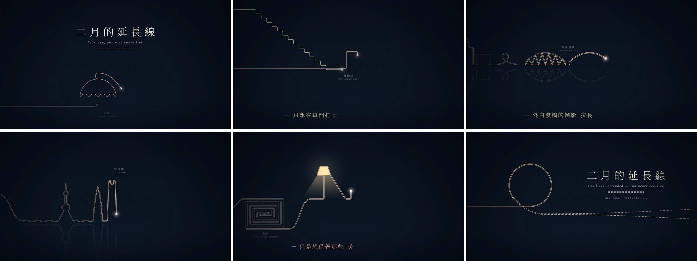

<div align="center">

# October Rain · February Line

**Two music videos drawn entirely by code — no image or video generation models, no footage.**

Every frame is a pure function of time: a web page draws frame `t`, headless Chrome captures it, ffmpeg adds the song.

   

</div>

## The films

| | 十月的微雨 · *A Drizzle in October* | 二月的延长线 · *February, on an Extended Line* |
|---|---|---|
| Style | Cel animation / line boil (hand-inked, frame by frame) | Line animation (one continuous line) |
| Spec | 1920×1080 · 24 fps, animated on 2s · 5:24 | 1920×1080 · 30 fps · 5:14 |
| Source | [`films/01-october-rain/`](films/01-october-rain) | [`films/02-february-line/`](films/02-february-line) |
| Song | [`songs/01-october-rain.mp3`](songs/01-october-rain.mp3) | [`songs/02-february-line.mp3`](songs/02-february-line.mp3) |

The finished MP4s are larger than GitHub's 100 MB per-file limit, so they are not in the tree. Download them from the [latest release](../../releases/latest).

### 十月的微雨 · A Drizzle in October


Warm paper, ink lines that are redrawn every second frame so they breathe, gouache fills slightly off register.

- **No face is ever drawn.** The rule comes from the lyric 「把臉龐留在鏡頭之外」 (*keeping my face outside the frame*): the two people appear only from behind, in photos cropped at the neck, or as featureless silhouettes.
- **Red scarf is her, yellow scarf is him.**
- **Red pencil marks what never happened**: an outline traced in secret, a sentence circling before it is said, a three-centimetre gap, a hand that was not taken.
- On 「如果時間能倒流」 (*if time could run backwards*) the rain falls upward.

### 二月的延长线 · February, on an Extended Line



A midnight ground and two thin lines: hers in rose gold, his in champagne.

- Each line is drawn on its own until the two meet on a metro platform as the train doors open.
- From there they run side by side, a constant few pixels apart, through one unbroken drawing of a single day: a garden pavilion, a riverside skyline, a truss bridge and its reflection, a steamer of dumplings, a photo kept in an album, a maze of showrooms, a lamp.
- **The two lines never touch.**
- The film ends on a circle that stops just short of closing; both lines then continue as dashed lines — in geometry, an *extension line* (延长线) — and run off the frame.
- The umbrella and the three dashed years at the start pick up where the first film ends. In the last chorus the camera travels the whole scroll again from the beginning.

## How it works

```text
song.mp3 ─► transcribe.py ─► align.py ─► build_timing.py ─► timing.json ─┐
            (word times)     (lyric sheet                (per-character   │
                              ↔ ASR, by pinyin)           times, beats)   ▼
                                                              film.js: window.renderAt(t)
                                                                          │
                                         headless Chrome, frame by frame ─┤
                                                                          ▼
                                                      ffmpeg ─► video.mp4 (+ the song)
```

1. **Timing.** `faster-whisper` produces word timestamps for the sung vocals. `align.py` aligns the known lyric sheet to that transcript with a pinyin-aware global alignment, so homophone mistakes in the transcript still land on the right character. `analyze.py` adds tempo, beats and energy envelopes.
2. **Picture.** Each film is one page exposing `window.renderAt(t)`. Nothing depends on wall-clock time: randomness is hashed from seeds, motion is closed-form.
3. **Render.** `harness/render.mjs` seeks the page to every frame, screenshots it, and encodes the sequence with the original song.

Notes on the two picture engines:

- **Cel film** — `lib/cel-engine.js` turns a centreline plus a pressure profile into a variable-width ink outline. "Boil" is the same drawing re-inked with a different noise seed, four variants cycling. Paper tooth is multiplied over every cel.
- **Line film** — the whole day is one polyline built from relative pen moves. The two visible lines are parallel offsets of that single path, which is why they can never cross. Shapes are routed as Euler paths so no stroke is retraced. A draw schedule maps lyric times to arc length, and a virtual camera follows the pen tips.

## Repository layout

| Path | Contents |
|---|---|
| `films/<name>/film.js` | The picture: all drawing and animation code for one film |
| `films/<name>/lyrics.txt` | Lyric sheet with singer tags (`F`, `M`, `D` for duet) |
| `films/<name>/timing.json` | Per-character lyric times, beats, onsets and energy envelopes |
| `songs/` | The two songs |
| `tools/` | `transcribe.py`, `align.py`, `analyze.py`, `build_timing.py`, and `sheet.py` for contact sheets |
| `harness/render.mjs` | Deterministic HTML-to-video renderer |
| `harness/preview.html` | Scrub any frame in a browser, with sound |
| `lib/cel-engine.js` | Hand-ink brush engine used by the cel film |
| `assets/` | Fonts (OFL) and paper textures |
| `docs/` | Preview images for this README |

## Render it yourself

Requirements: Node.js 22+, Google Chrome, ffmpeg. Rebuilding the timing files also needs Python 3.11+.

```bash
npm install

# full renders → films/<name>/out/video.mp4
node harness/render.mjs films/01-october-rain  --workers 4 --audio songs/01-october-rain.mp3  --crf 16
node harness/render.mjs films/02-february-line --workers 5 --audio songs/02-february-line.mp3 --crf 16

# a contact sheet of chosen frames
python tools/sheet.py films/02-february-line 3 5,90,260 sheet.jpg

# scrub in the browser
python -m http.server 8000
# http://localhost:8000/harness/preview.html?demo=01-october-rain
```

Chrome is found automatically on Windows and macOS; set `MG_CHROME=<path>` otherwise.

To rebuild a timing file from a song:

```bash
pip install faster-whisper librosa soundfile pyloudnorm pypinyin opencc-python-reimplemented pillow
mkdir work
ffmpeg -i songs/01-october-rain.mp3 -vn -ac 1 -ar 16000 work/01-october-rain.16k.wav
ffmpeg -i songs/01-october-rain.mp3 -vn -ar 48000 work/01-october-rain.48k.wav
python tools/transcribe.py 01-october-rain medium
python tools/align.py 01-october-rain medium
python tools/analyze.py 01-october-rain
python tools/build_timing.py 01-october-rain
```

## Known limitations

- Lyric timing is automatic (speech recognition plus alignment). Expect roughly ±0.3 s per character; it has not been hand-corrected.
- One line of *February*, 「把最深的依戀　藏進最輕的對白」, is on the lyric sheet but is not sung in the recording — a guitar solo plays instead. The film shows it as faint text during the solo.
- The cel film's paper grain changes on every drawing, which makes it expensive to compress. The release copy is about 13 Mb/s.

## Credits

Songs by chanmeng666, generated with Suno. Method, renderer and cel engine adapted from [mg-styles-15](https://github.com/Vincentwei1021/mg-styles-15) (MIT). Fonts are SIL OFL. Full list in [CREDITS.md](CREDITS.md).
